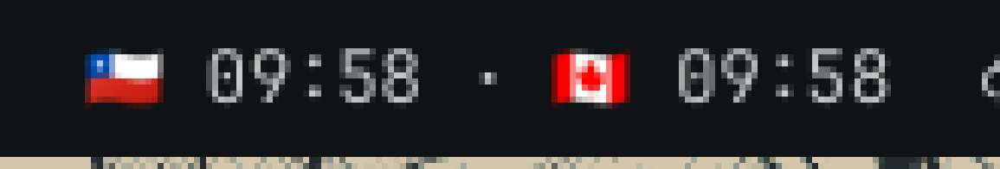

# DST Clocks

An Omarchy bar widget that shows a row of fixed timezones — by default **Santiago, Chile** and **Toronto, Canada** — as emoji + 24h time, right next to the stock clock:



```
🇨🇱 14:05 · 🇨🇦 12:05 · 🇯🇵 02:05
```

Add as many clocks as you like, remove them, and change each clock's emoji — straight from the bar.

## How it works

Qt's QML runtime has no `Intl`, so timezone math can't be done in-process. Instead, once per minute (driven by Quickshell's `SystemClock` at minute precision) the widget runs one tiny process:

```sh
env TZ=America/Santiago date +%H:%M
env TZ=America/Toronto  date +%H:%M
# …one per configured zone
```

so every country's DST rules come straight from the system tzdata — Chile's and Canada's often-conflicting clock changes need no hand-maintained offsets.

Clicking the label opens the Omarchy menu (`dst-clocks-menu.sh`), which edits the widget's entry in `~/.config/omarchy/shell.json`; the shell hot-reloads the bar within a second.

## Bar interactions

Click the clocks to open the menu:

- **Add clock** — pick a timezone from `timedatectl list-timezones`, then pick an emoji from the curated flag list (or *Other* to type/paste anything).
- **Remove clock** — pick the clock to drop.
- **Change emoji** — pick a clock, then its new emoji.

Pressing `Esc` at any prompt cancels without changing anything.

## Configuration

Clocks live in a `zones` array on the widget's layout entry in `~/.config/omarchy/shell.json`:

```json
{
  "id": "alvarosaavedra.dst-clocks",
  "zones": [
    { "flag": "🇨🇱", "tz": "America/Santiago" },
    { "flag": "🇨🇦", "tz": "America/Toronto" }
  ]
}
```

`shell.json` hot-reloads on save, so hand edits take effect immediately.

The same edits from a shell (what the menu flow calls itself):

```sh
~/.config/omarchy/plugins/alvarosaavedra.dst-clocks/dst-clocks-menu.sh add Asia/Tokyo 🇯🇵
~/.config/omarchy/plugins/alvarosaavedra.dst-clocks/dst-clocks-menu.sh remove Asia/Tokyo
~/.config/omarchy/plugins/alvarosaavedra.dst-clocks/dst-clocks-menu.sh emoji America/Toronto 🍁
~/.config/omarchy/plugins/alvarosaavedra.dst-clocks/dst-clocks-menu.sh list
```

The older per-zone keys (`zone1Flag`, `zone1Tz`, `zone2Flag`, `zone2Tz`) are still read as a fallback when `zones` is absent; the first edit writes the merged list back as `zones`.

Notes:

- `flag` is any string — emoji, text, whatever your bar font renders.
- Writes go directly to `shell.json` on purpose: `omarchy bar set <id> zones '[…]' --json` cannot transport arrays, because `qs`'s IPC CLI splits comma-containing arguments. Scalars are unaffected.
- The menu flow needs `jq`, `timedatectl`, and the shipped `omarchy-menu-select` / `omarchy-menu-input` helpers (all standard on Omarchy).

## Install

```sh
omarchy plugin add https://github.com/alvarosaavedra/omarchy-dst-clocks.git --enable
```

For a local checkout:

```sh
omarchy plugin add ~/Projects/omarchy-dst-clocks --enable
```

Then add the widget to the bar in `~/.config/omarchy/shell.json`, e.g. right after the stock clock in `bar.layout.center`:

```json
{
  "id": "alvarosaavedra.dst-clocks"
}
```

`shell.json` hot-reloads on save; if the widget doesn't appear, run `omarchy-shell shell rescanPlugins`.

## Remove

```sh
omarchy plugin remove alvarosaavedra.dst-clocks
```

(Also remove its entry from `bar.layout.center` in `~/.config/omarchy/shell.json` if you added it by hand.)

## Development

```sh
omarchy plugin validate .
qmllint -I /usr/share/omarchy/shell BarWidget.qml
bash -n dst-clocks-menu.sh
```

## License

MIT
